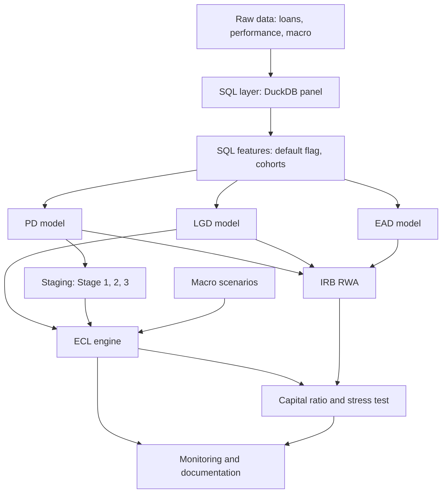

# IFRS 9 ECL and capital adequacy framework

End-to-end credit risk project in Python and SQL: PD, LGD and EAD models, IFRS 9 staging,
12-month and lifetime expected credit loss (ECL) under macro scenarios, and Basel IRB risk-weighted
assets (RWA) with a simple capital ratio and stress test. A logistic scorecard is the main PD model;
LightGBM / CatBoost is the benchmark.

> Status: version 0.1.0. See the checklist at the bottom and `CHANGELOG.md`.

## Results

Generated by `make report` from `reports/tables/`. Values appear after the pipelines have run.

**Data source: TBD.** State here whether the results come from real Freddie Mac data or from simulated data
(`make sim`). Results from simulated data describe the simulation, not the mortgage market.

<!-- RESULTS:START -->
| Item | Value |
|---|---|
| PD scorecard Gini (out-of-time) | 0.505 |
| PD LightGBM Gini (out-of-time) | 0.480 |
| Stage 1 / 2 / 3 share of exposure | 95.64% / 1.63% / 2.72% |
| ECL / exposure (base scenario) | 0.75% |
| ECL / exposure (downside scenario) | 1.54% |
| RWA density (RWA / EAD, base) | 25.59% |
| Capital ratio, base to downside (assumed 12% start) | 12.0% to 4.2% (-7.79 pp) |
<!-- RESULTS:END -->

## Pipeline



## Repo structure

```
sql/        DuckDB scripts (01 to 08); 04 and 05 are run by the pipelines
src/        Python modules: data loading, woe, pd_model, benchmark, pd_pipeline, lifetime_pd, lgd, ead,
            staging, ecl, ecl_portfolio, ecl_pipeline, rwa, capital, monitoring, report, gates, validation
tests/      unit tests (RWA formula, validation metrics)
docs/       model_documentation.md (written like a bank model development document)
notebooks/  EDA and results
data/       download instructions only, no raw data in git
```

## Data

- Loan and performance data: Freddie Mac Single-Family Loan-Level Dataset (free registration).
  Fallback: Home Credit Default Risk (Kaggle).
- Macro data: unemployment, house price index, GDP from FRED.
- Put raw files in `data/raw/`. They are ignored by git.
- Download and loading instructions: `data/README.md`. Column layouts are in `src/freddie_schema.py`;
  verify them against the user guide of your file version.

## How to run

```bash
make install
make test
make data-synthetic     # smoke test of the whole pipeline on synthetic data
make data-freddie       # real data: see data/README.md for downloads
make sim                # no real data? simulate Freddie Mac style files and load them
make quality            # data quality report
make eda                # charts in reports/figures/
make pd                 # PD scorecard and benchmark, validation gates, writes scores
make lifetime           # lifetime PD by scenario, LGD model, EAD path
make ecl                # staging, ECL by scenario, RWA, stress test (run make pd first)
make monitor            # PSI over time, PD backtest, stage migration
make report             # fill the results tables in README and docs from reports/tables
make check              # lint, tests, synthetic end-to-end smoke test
```

## Key assumptions (document and justify each in docs/model_documentation.md)

- Default: 90+ days past due.
- Freddie Mac files: both the layout before and from Release 47 (July 2026) are supported and detected
  automatically (`data/README.md`).
- PD target: default within the next 12 months. Observations in the last 12 months of the data are excluded
  from training (their outcome is not fully observed) but are scored for staging and ECL.
- PD split: train on early months, validate on the last months (out-of-time), with a 12-month gap between
  them so outcome windows do not overlap. This needs about 3 or more origination years of data.
- Stage 2 (SICR): 30 DPD backstop plus a relative and absolute PD increase rule. Thresholds are
  assumptions and must be tested for sensitivity.
- Scenario weights for base, upside and downside. Scenario shocks (`src/lifetime_pd.py`) are illustrative
  assumptions relative to the last observed macro values, not official forecasts.
- Lifetime PD: roll-rate (Markov) model over the states current, 30, 60 and 90+ days late; loan characteristics
  are held constant in the projection and prepayment is treated as censoring.
- The PD scorecard has no macro variables; the economy enters through the roll-rate model and the scenarios.
- SICR compares the PD with the PD of the same loan with a clean payment history, not with the PD at the first
  observation (which rises with loan age).
- EAD: amortisation schedule with a constant prepayment rate (default 6% CPR, an assumption).
- LGD: fractional logit on resolved defaults with a realised loss, clipped to [0, 1]. Cured loans and
  unresolved defaults are not represented (workout bias).
- Reporting date: the last month in the data. The portfolio is all loans with a balance at that date.
- ECL: Stage 1 uses the next 12 months, Stage 2 the remaining contractual term, both discounted at the
  contractual rate. Stage 3 ECL is LGD times EAD (no discounting). LGD is evaluated per scenario with the
  macro values 12 months ahead.
- RWA: IRB formula for residential mortgages with the 12-month PD of each scenario. Defaulted exposures are
  excluded from RWA.
- Stress test: extra provisions (downside ECL minus base ECL) reduce capital one for one, with no profit,
  tax or management actions. Starting capital is 12% of base RWA, an assumption.
- Capital for the ratio is an assumption, shown as a sensitivity table, not the real capital of a bank.
- IRB parameters (asset correlation, PD floor, confidence level) follow the Basel framework; verify
  them against the current text before reporting numbers.

## Checklist

- [x] SQL layer and default flag
- [x] PD scorecard and ML benchmark
- [x] Lifetime PD term structure
- [x] LGD and EAD
- [x] Staging and ECL with scenarios
- [x] IRB RWA and capital ratio
- [x] Stress test
- [x] Monitoring (Gini, KS, PSI, calibration, backtest)
- [ ] Model documentation (fill the TBD items after running on real data)

## Development

```bash
make install     # dependencies
make test        # unit tests, SQL tests, validation gates, coverage
make lint        # ruff
make format      # auto-fix and format
make sql-lint    # sqlfluff (DuckDB dialect)
```

- Tests run on synthetic data (`src/synthetic.py`), so CI needs no real data.
- `src/gates.py` holds the PD validation gates (Gini, KS, calibration, rank order, PSI). Any new PD model
  must pass them (`tests/test_gates.py` shows how).
- CI (`.github/workflows/ci.yml`) runs lint and tests on Python 3.11 and 3.12 for every push and pull
  request. Pushing a tag like `v0.1.0` runs the release workflow.

[](https://github.com/elgunismayil0v2001/ecl-framework/actions/workflows/ci.yml)
