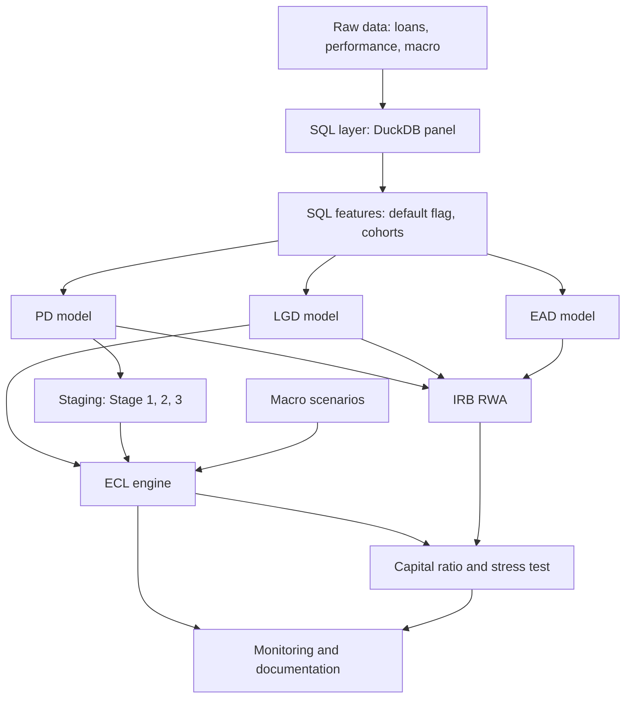

# IFRS 9 ECL and capital adequacy framework

End-to-end credit risk project in Python and SQL: PD, LGD and EAD models, IFRS 9 staging,
12-month and lifetime expected credit loss (ECL) under macro scenarios, and Basel IRB risk-weighted
assets (RWA) with a simple capital ratio and stress test. A logistic scorecard is the main PD model;
LightGBM / CatBoost is the benchmark.

> Status: work in progress. See the checklist at the bottom.

## Results (fill in when ready)

| Item | Value |
|---|---|
| PD scorecard Gini (out-of-time) | TBD |
| PD LightGBM Gini (out-of-time) | TBD |
| Stage 1 / 2 / 3 share of exposure | TBD |
| ECL / exposure (base scenario) | TBD |
| ECL / exposure (downside scenario) | TBD |
| RWA density (RWA / EAD) | TBD |
| Capital ratio change, base to downside | TBD |

## Pipeline



## Repo structure

```
sql/        DuckDB scripts, run in order (01 to 06)
src/        Python modules: data loading, woe, pd_model, benchmark, pd_pipeline, gates, lgd, ead, ecl, rwa, validation
tests/      unit tests (RWA formula, validation metrics)
docs/       model_documentation.md (written like a bank model development document)
notebooks/  EDA and results
data/       download instructions only, no raw data in git
```

## Data

- Loan and performance data: Freddie Mac Single-Family Loan-Level Dataset (free registration).
  Fallback: Home Credit Default Risk (Kaggle).
- Macro data: unemployment, house price index, GDP from FRED.
- Put raw files in `data/raw/`. They are ignored by git.
- Download and loading instructions: `data/README.md`. Column layouts are in `src/freddie_schema.py`;
  verify them against the user guide of your file version.

## How to run

```bash
make install
make test
make data-synthetic     # smoke test of the whole pipeline on synthetic data
make data-freddie       # real data: see data/README.md for downloads
make quality            # data quality report
make eda                # charts in reports/figures/
make pd                 # PD scorecard and benchmark, validation gates, writes scores
```

## Key assumptions (document and justify each in docs/model_documentation.md)

- Default: 90+ days past due.
- PD target: default within the next 12 months. Observations in the last 12 months of the data are excluded
  from training (their outcome is not fully observed) but are scored for staging and ECL.
- PD split: train on early months, validate on the last months (out-of-time), with a 12-month gap between
  them so outcome windows do not overlap. This needs about 3 or more origination years of data.
- Stage 2 (SICR): 30 DPD backstop plus a relative and absolute PD increase rule. Thresholds are
  assumptions and must be tested for sensitivity.
- Scenario weights for base, upside and downside.
- Capital for the ratio is an assumption, shown as a sensitivity table, not the real capital of a bank.
- IRB parameters (asset correlation, PD floor, confidence level) follow the Basel framework; verify
  them against the current text before reporting numbers.

## Checklist

- [ ] SQL layer and default flag
- [ ] PD scorecard and ML benchmark
- [ ] Lifetime PD term structure
- [ ] LGD and EAD
- [ ] Staging and ECL with scenarios
- [ ] IRB RWA and capital ratio
- [ ] Stress test
- [ ] Monitoring (Gini, KS, PSI, calibration, backtest)
- [ ] Model documentation

## Development

```bash
make install     # dependencies
make test        # unit tests, SQL tests, validation gates, coverage
make lint        # ruff
make format      # auto-fix and format
make sql-lint    # sqlfluff (DuckDB dialect)
```

- Tests run on synthetic data (`src/synthetic.py`), so CI needs no real data.
- `src/gates.py` holds the PD validation gates (Gini, KS, calibration, rank order, PSI). Any new PD model
  must pass them (`tests/test_gates.py` shows how).
- CI (`.github/workflows/ci.yml`) runs lint and tests on Python 3.11 and 3.12 for every push and pull
  request. Pushing a tag like `v0.1.0` runs the release workflow.

[](https://github.com/elgunismayil0v2001/ecl-framework/actions/workflows/ci.yml)
