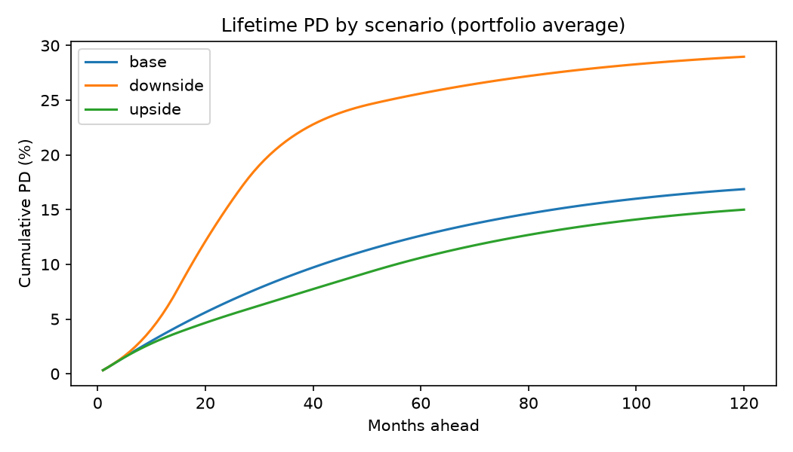
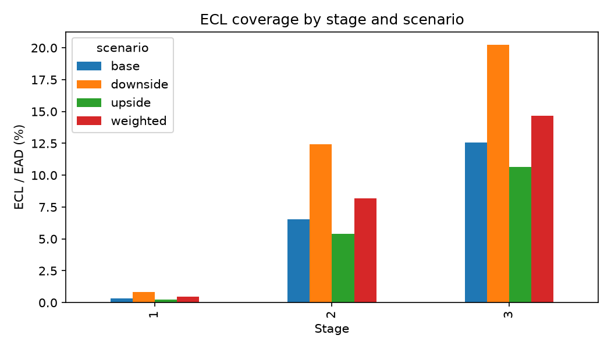
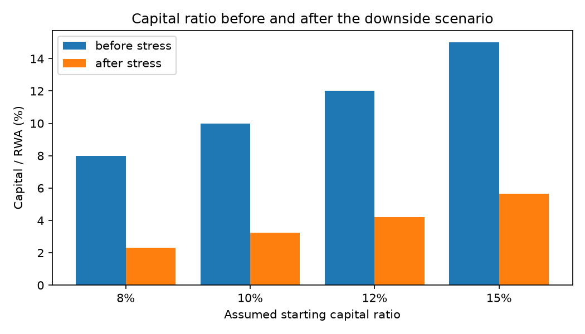
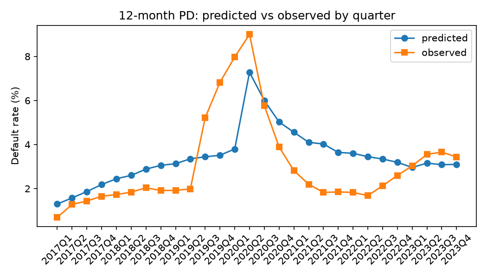
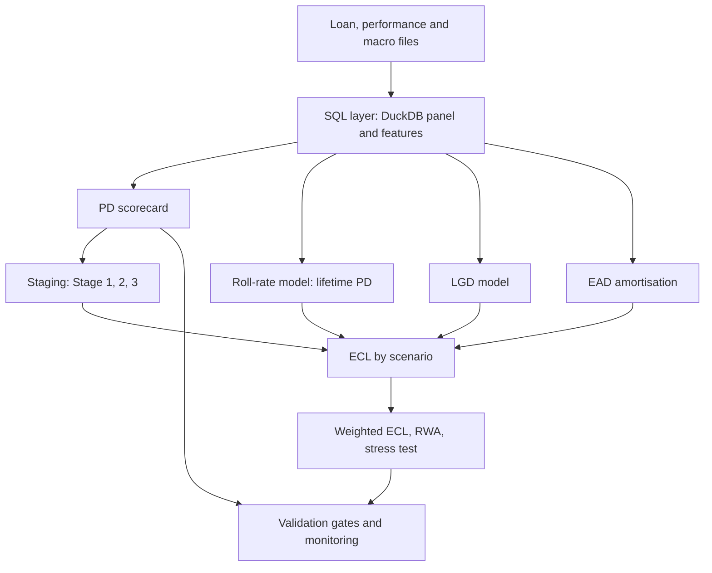

# IFRS 9 expected credit loss and capital adequacy framework

[](https://github.com/elgunismayil0v2001/ecl-framework/actions/workflows/ci.yml)


An end-to-end credit risk model for a residential mortgage portfolio, written in Python and SQL (DuckDB). It covers
what a bank's model development team builds for IFRS 9 and capital: PD, LGD and EAD models, staging, 12-month and
lifetime expected credit loss (ECL) under macro scenarios, Basel IRB risk-weighted assets (RWA), a capital stress test,
model validation gates and monitoring. The model documentation is written like a bank's model development document
(`docs/model_documentation.md`).

<!-- DATA_SOURCE:START -->
Data source: **simulated data (make sim)**. 15,000 loans, 603,209 loan-months, 2017-02 to 2024-12.

> These results describe a simulation, not the mortgage market.
<!-- DATA_SOURCE:END -->

## Key results

<!-- RESULTS:START -->
| Item | Value |
|---|---|
| PD scorecard Gini (out-of-time) | 0.507 |
| PD LightGBM Gini (out-of-time) | 0.490 |
| Stage 1 / 2 / 3 share of exposure | 95.64% / 1.63% / 2.72% |
| ECL / exposure (base scenario) | 0.75% |
| ECL / exposure (downside scenario) | 1.56% |
| RWA density (RWA / EAD, base) | 25.78% |
| Capital ratio, base to downside (assumed 12% start) | 12.0% to 4.2% (-7.82 pp) |
<!-- RESULTS:END -->

| Lifetime PD by scenario | ECL coverage by stage |
|---|---|
|  |  |
| **Capital ratio under stress** | **PD backtest by quarter** |
|  |  |

Tables and charts are generated into `reports/` by the pipeline (`make demo`) and inserted here by `make report`.

## What the framework does

| Area | What it does | Code |
|---|---|---|
| Data | Loads Freddie Mac loan files (both file layouts, before and from Release 47 of July 2026) and FRED macro series; 17 data quality checks | `src/load_freddie.py`, `src/load_macro.py`, `src/data_quality.py` |
| PD | WoE scorecard (monotone bins, free-shape seasoning bins, sign checks) and a LightGBM benchmark; out-of-time split with a 12-month gap; validation gates | `src/pd_model.py`, `src/woe.py`, `src/benchmark.py`, `src/gates.py` |
| Lifetime PD | Roll-rate (Markov) model over current, 30, 60 and 90+ days late, projected under base, upside and downside macro scenarios | `src/rollrate.py`, `src/lifetime_pd.py` |
| LGD and EAD | Fractional logit LGD on resolved defaults; amortisation schedule with prepayment | `src/lgd.py`, `src/ead.py` |
| IFRS 9 | Staging with a significant-increase-in-credit-risk rule and sensitivity tables; portfolio ECL; probability-weighted ECL | `src/staging.py`, `src/ecl_portfolio.py`, `sql/05_ecl_aggregation.sql` |
| Capital | IRB RWA for residential mortgages, expected loss against ECL, stress test | `src/rwa.py`, `src/capital.py` |
| Monitoring | PSI over time, correlation-adjusted PD backtest, stage migration, consistency between PD models | `src/monitoring.py` |



## Quick start

```bash
git clone https://github.com/elgunismayil0v2001/ecl-framework.git && cd ecl-framework
python3 -m venv .venv && source .venv/bin/activate
pip install -r requirements-dev.txt
make check     # lint, tests, synthetic smoke test
make demo      # simulate data, run every pipeline, write reports/, fill the tables in this README
```

Real data: `make data-freddie` (download instructions in `data/README.md`). No access to the Freddie Mac data?
`make sim` simulates files in the same layout, and every later step runs unchanged. Individual steps:
`make quality`, `make pd`, `make lifetime`, `make ecl`, `make monitor`, `make eda`, `make report`.

## Design decisions and lessons

Running the whole chain end to end exposed several modelling mistakes, which I fixed and covered with tests:

- **A one-month default hazard is zero for a current loan.** Delinquency moves one month at a time, so a hazard model
  gave a 10-year PD of 0.95%, below the observed 12-month default rate of about 3.5%, which is impossible. The
  lifetime PD now comes from a roll-rate model.
- **Equal-count bins hid the strongest variable.** 30 and 60 days late are 1.7% of the rows, so they were merged into the
  current loans (information value 0.000). Low-cardinality features now get one bin per value.
- **Macro variables in the scorecard memorised the cycle** (calibration error +58%, score PSI 0.63). They are now only in
  the lifetime model and the scenarios.
- **Seasoning is not monotone.** Default risk rises and then falls with loan age; forcing monotone age bins failed the
  calibration and rank-order gates. Age and balance bins are now free-shape.
- **SICR against the PD at origination put every loan in Stage 2,** because PD rises with age. The reference is now the
  PD of the same loan with a clean payment history.
- **Leakage:** the row where a loan leaves the pool has no balance, which revealed the outcome. These rows are excluded
  from the modelling sample.
- **The backtest z-test counted each loan three times and assumed independent defaults,** so 25 of 28 quarters were red.
  It now uses quarter-end snapshots and a default correlation adjustment (an assumption).

## Testing and CI

Unit tests with closed-form checks (RWA, ECL, amortisation), property tests (bounds, monotonicity, scenario ordering),
SQL integration tests on synthetic and simulated data, and tests for the validation gates themselves. GitHub Actions
runs lint and tests on Python 3.11 and 3.12; a tag like `v0.1.0` builds a release.

```bash
make test    # pytest with coverage (minimum 60%)
make lint    # ruff
```

## Limitations

This is a portfolio project, not a production model. Public mortgage data (or a simulation of it), a closed book,
illustrative scenarios, a constant prepayment rate, no downturn LGD or regulatory floors, no defaulted-exposure RWA, and
assumed capital. Every assumption is listed in `docs/model_documentation.md`, section 9. If the results come from simulated
data, they describe the simulation, not the mortgage market.

## Repository

```
sql/        DuckDB scripts: schema, panel, features, staging, ECL aggregation, monitoring, LGD and roll-rate data
src/        the framework (see the table above), plus simulate.py and report.py
tests/      unit, integration and end-to-end tests
docs/       model_documentation.md
data/       download instructions only; raw data is not in git
reports/    generated tables and charts
notebooks/  exploratory analysis
```

Stack: Python, DuckDB and SQL, pandas, NumPy, SciPy, scikit-learn, LightGBM, matplotlib, pytest, ruff, GitHub Actions.

Released under the MIT license (`LICENSE`).
